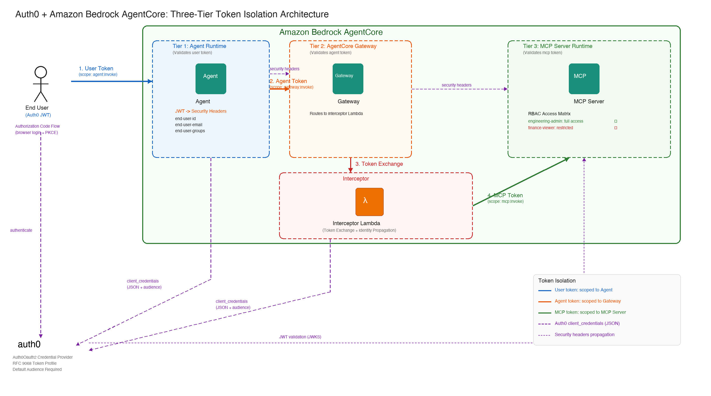
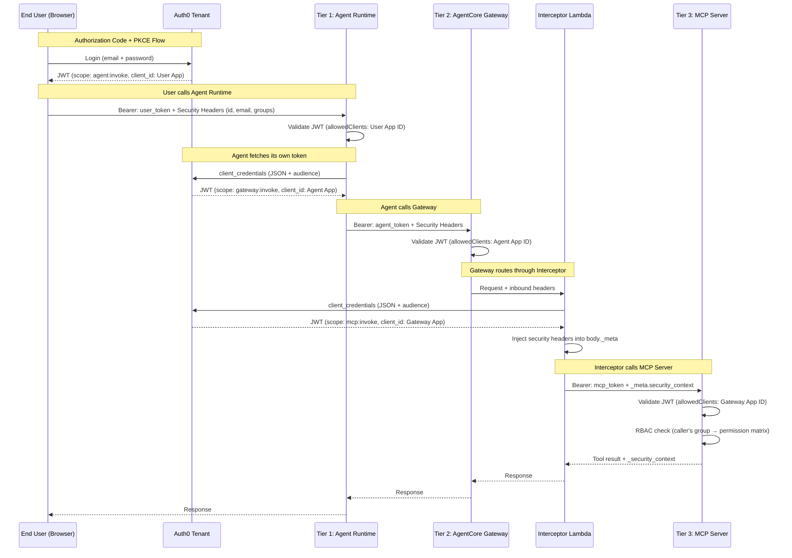

# Securing AI Agents with Auth0 and AgentCore: Per-Tier Token Isolation and RBAC

Integrate Auth0 as an external identity provider with AgentCore's three-tier architecture, featuring per-tier token isolation, RBAC enforcement, and end-to-end security header propagation.

This sample demonstrates how organizations using Auth0 can secure their AgentCore deployments with the same rigor as AWS-native IDPs, while maintaining their existing identity infrastructure.

## Architecture

### Architecture



### Token Flow (Sequence)



## How It Works

The user logs in via Auth0 (Authorization Code + PKCE) and gets a JWT scoped to `agent:invoke`. The user calls the Agent Runtime with this token plus security headers (user ID, email, group). The Agent Runtime validates the JWT, then fetches its own token (`gateway:invoke`) and calls the Gateway. The Gateway validates the agent token, routes through the Interceptor Lambda which fetches a fresh token (`mcp:invoke`) and injects security headers into the JSON-RPC body. The MCP Server validates the MCP token, reads the caller's identity, enforces RBAC, and returns data.

No token is ever forwarded downstream. Each tier independently authenticates with Auth0.

## Token Isolation

| Token | Scope | Issued To | Accepted By | How Obtained |
|-------|-------|-----------|-------------|--------------|
| User Token | `agent:invoke` | End user (browser) | Agent Runtime | Authorization Code + PKCE |
| Agent Token | `gateway:invoke` | Agent Runtime | Gateway | Client Credentials (JSON) |
| MCP Token | `mcp:invoke` | Interceptor Lambda | MCP Server | Client Credentials (JSON) |

## RBAC (Role-Based Access Control)

| Role | list_projects | property_details | budget_summary |
|------|:---:|:---:|:---:|
| `engineering-admin` | ✓ | ✓ | ✓ |
| `finance-viewer` | ✓ | ✗ | ✓ |
| (no role) | ✗ | ✗ | ✗ |

## Security Headers (End-to-End Propagation)

| Header | Purpose |
|--------|---------|
| `X-Amzn-Bedrock-AgentCore-Runtime-Custom-End-User-Id` | Caller's user ID |
| `X-Amzn-Bedrock-AgentCore-Runtime-Custom-End-User-Email` | Caller's email |
| `X-Amzn-Bedrock-AgentCore-Runtime-Custom-End-User-Groups` | Caller's Auth0 roles |

The Interceptor Lambda extracts these from the inbound Gateway request and injects them into `params._meta.security_context` in the JSON-RPC body, since `requestHeaderAllowlist` doesn't pass custom headers to the container.

---

## Step-by-Step Guide

### Prerequisites

- Python 3.10+
- AWS account with AgentCore permissions
- Auth0 account (free tier is sufficient)

### Step 1: Auth0 Setup

#### 1.1 Create an API (Resource Server)

Navigate to **Applications > APIs > Create API**:
- Name: `AgentCore Demo API`
- Identifier: `https://agentcore-demo-api`
- Signing Algorithm: RS256

Configure the API:
- **Permissions tab**: Add `agent:invoke`, `gateway:invoke`, `mcp:invoke`
- **Settings > RBAC**: Enable RBAC + Add Permissions in Access Token
- **Settings > Access Token Settings**: Change Access Token Profile to **RFC 9068**

> RFC 9068 is required because AgentCore's `allowedClients` checks the `client_id` claim. Auth0's default profile uses `azp` instead, which AgentCore doesn't recognize.

#### 1.2 Set Default Audience (Optional)

Go to **Settings** (gear icon) > **API Authorization Settings**:
- Set Default Audience to `https://agentcore-demo-api`
- Save

> This is optional when using the `Auth0Oauth2` credential provider vendor (which handles audience automatically). It's still recommended as a fallback for any tools or services that don't pass an explicit audience.

#### 1.3 Create Three Applications

**Agent App** (Machine-to-Machine):
- Type: Machine to Machine
- Authorize for: AgentCore Demo API
- Granted scopes: `gateway:invoke`

**Gateway App** (Machine-to-Machine):
- Type: Machine to Machine
- Authorize for: AgentCore Demo API
- Granted scopes: `mcp:invoke`

**User Web App** (Regular Web Application):
- Type: Regular Web Application
- Allowed Callback URLs: `http://localhost:8080/callback`
- Allowed Logout URLs: `http://localhost:8080`
- Grant Types: Authorization Code
- Go to APIs > AgentCore Demo API > Machine to Machine Applications > toggle User Web App to **Authorized** (both User Access and Client Access)

#### 1.4 Create Roles and Users

**User Management > Roles:**
- `engineering-admin` — assign all API permissions
- `finance-viewer` — assign all API permissions (RBAC is enforced at MCP Server level via security headers)

**User Management > Users:**
- `alice@example.com` — assign role `engineering-admin`
- `bob@example.com` — assign role `finance-viewer`

#### 1.5 Create Auth0 Actions

**Post Login Action** (Actions > Library > Build Custom > trigger: Login / Post Login):
```javascript
exports.onExecutePostLogin = async (event, api) => {
  const namespace = 'https://agentcore.example.com/';
  const roles = event.authorization?.roles || [];
  api.accessToken.setCustomClaim(`${namespace}roles`, roles);
  api.accessToken.setCustomClaim(`${namespace}email`, event.user.email);
};
```
Deploy and add to **Actions > Triggers > post-login** flow.

**M2M Credentials Exchange Action** (Actions > Library > Build Custom > trigger: M2M / Client Credentials):
```javascript
exports.onExecuteCredentialsExchange = async (event, api) => {
  api.accessToken.setCustomClaim('client_id', event.client.client_id);
};
```
Deploy and add to **Actions > Triggers > credentials-exchange** flow.

### Step 2: Configure Environment

```bash
cd 02-use-cases/auth0-auth-three-tier-end-to-end-demo
cp .env.example .env
# Edit .env with your Auth0 domain, client IDs/secrets, and AWS credentials
```

### Step 3: Run the Notebook

```bash
python3.10 -m venv .venv
source .venv/bin/activate
pip install jupyter ipykernel boto3 httpx mcp bedrock-agentcore bedrock-agentcore-starter-toolkit python-dotenv
jupyter notebook auth0-auth-three-tier-end-to-end-demo.ipynb
```

Run cells sequentially. The notebook will:
1. Deploy MCP Server to AgentCore Runtime (~5-10 min)
2. Deploy Gateway with Interceptor Lambda (~5 min)
3. Deploy Agent Runtime (~5-10 min)
4. Test full chain as Alice (full access) and Bob (limited access)
5. Verify token isolation
6. Cleanup all resources

---

## Connecting Your Production Auth0 Tenant (Coming from Cognito)

If you prototyped with Amazon Cognito and your organization uses Auth0 in production, here's what changes. Both paths have been tested end-to-end with AgentCore's three-tier architecture.

### Concept Mapping

| Amazon Cognito | Auth0 | Notes |
|---|---|---|
| User Pool | Auth0 Tenant | Sign up at auth0.com |
| Resource Server | API (Applications > APIs) | Cognito prefixes scopes; Auth0 doesn't |
| App Client (client_credentials) | M2M Application | Authorize for API with specific scopes |
| App Client (authorization_code) | Regular Web Application | Add callback URLs |
| Pre Token Generation Lambda | Post Login Action + M2M Action | Auth0 uses Actions, not Lambda triggers |
| Cognito Groups | Auth0 Roles | Both support group/role-based access |
| Hosted UI / Cognito Domain | Auth0 Universal Login | Both provide hosted login pages |

### Code Changes

#### URLs
```python
# Cognito
ISSUER = f"https://cognito-idp.{region}.amazonaws.com/{pool_id}"
DISCOVERY = f"{ISSUER}/.well-known/openid-configuration"
TOKEN_ENDPOINT = f"https://{domain}.auth.{region}.amazoncognito.com/oauth2/token"

# Auth0
ISSUER = f"https://{AUTH0_DOMAIN}/"
DISCOVERY = f"https://{AUTH0_DOMAIN}/.well-known/openid-configuration"
TOKEN_ENDPOINT = f"https://{AUTH0_DOMAIN}/oauth/token"
```

#### Token Requests
```python
# Cognito: form-encoded + Basic auth
credentials = base64.b64encode(f"{client_id}:{client_secret}".encode()).decode()
response = httpx.post(TOKEN_ENDPOINT,
    headers={"Authorization": f"Basic {credentials}",
             "Content-Type": "application/x-www-form-urlencoded"},
    data={"grant_type": "client_credentials",
          "scope": "agentcore-api/mcp:invoke"})

# Auth0: JSON body with audience
response = httpx.post(TOKEN_ENDPOINT,
    headers={"Content-Type": "application/json"},
    json={"client_id": client_id, "client_secret": client_secret,
          "audience": AUTH0_AUDIENCE,
          "grant_type": "client_credentials", "scope": "mcp:invoke"})
```

#### Scope Format
```python
# Cognito (prefixed with resource server identifier)
MCP_SCOPE = "agentcore-api/mcp:invoke"

# Auth0 (plain)
MCP_SCOPE = "mcp:invoke"
```

#### Groups/Roles Claim
```python
# Cognito
groups = token_claims.get("cognito:groups", [])

# Auth0 (namespaced custom claim via Action)
roles = token_claims.get("https://agentcore.example.com/roles", [])
```

### New Requirements (Not Needed with Cognito)

| Requirement | Why |
|---|---|
| `audience` parameter in every token request | Auth0 requires it; without it you get opaque tokens |
| Default Audience in tenant settings | AgentCore's OAuth2 Credential Provider can't pass `audience` |
| RFC 9068 Access Token Profile | Cognito includes `client_id` by default; Auth0 needs RFC 9068 |
| Two separate Actions | Cognito uses one Lambda trigger; Auth0 needs Login + M2M Actions |
| Explicit API authorization for User Web App | Cognito App Clients are authorized by default |

---

## Coming from the Okta Sample

If you've seen the [Okta three-tier demo](https://github.com/awslabs/agentcore-samples/tree/main/02-use-cases/okta-auth-three-tier-end-to-end-demo), here's a quick diff:

| Aspect | Okta | Auth0 |
|---|---|---|
| Discovery URL | Includes auth server ID in path | Simpler: `https://{domain}/.well-known/openid-configuration` |
| Token request format | Form-encoded + Basic auth | JSON body |
| `audience` parameter | Not needed | Required in every request |
| `client_id` in token | Built-in | Requires RFC 9068 profile |
| Custom claims | Claims tab on Auth Server | Actions (two separate triggers) |
| DPoP | Must disable on all apps | Not applicable |
| Default Audience | Not needed | Required for OAuth2 Credential Provider |

The AgentCore infrastructure (Gateway, Interceptor pattern, MCP Server, RBAC, security headers) is identical.

---

## AgentCore Integration Gotchas

Issues specific to Auth0 + AgentCore that aren't in generic Auth0 docs:

1. **`allowedClients` needs RFC 9068** — AgentCore checks `client_id` claim. Auth0 default uses `azp`. Switch to RFC 9068 profile.

2. **OAuth2 Credential Provider — use `Auth0Oauth2` vendor** — AgentCore has a native `Auth0Oauth2` credential provider vendor that handles the `audience` parameter automatically. If you use `CustomOauth2` instead, you'll need to set a Default Audience in Auth0 tenant settings as a workaround.

3. **Two Actions needed** — Post Login only fires for user logins. M2M tokens need a separate credentials-exchange Action.

4. **`allowedAudience` is required** — Unlike Cognito/Okta where audience is implicit, Auth0 tokens carry it explicitly. Always configure `allowedAudience`.

5. **User Web App needs explicit API authorization** — Toggle both User Access and Client Access in the API's Machine to Machine Applications tab.

6. **Auth0 issuer has trailing slash** — `https://{domain}/` — AgentCore handles this via discovery URL, but be aware for manual validation.

---

## Project Structure

```
├── auth0-auth-three-tier-end-to-end-demo.ipynb   # Main deployment notebook
├── .env.example                                   # Environment variable template
├── requirements.txt                               # MCP Server container dependencies
└── README.md                                      # This file (includes Mermaid diagrams)
```

Files generated at deploy time (excluded from repo):
- `mcp_server.py`, `agent_runtime/`, `Dockerfile`, `.bedrock_agentcore.yaml`

---

## Resources

- [Amazon Bedrock AgentCore Documentation](https://docs.aws.amazon.com/bedrock-agentcore/)
- [Auth0 Documentation](https://auth0.com/docs)
- [Auth0 RFC 9068 Token Profile](https://auth0.com/docs/secure/tokens/access-tokens/access-token-profiles)
- [Auth0 Actions Documentation](https://auth0.com/docs/customize/actions)
- [MCP Protocol Spec](https://modelcontextprotocol.io/)
- [OAuth 2.0 RFC 6749](https://tools.ietf.org/html/rfc6749)
- [RFC 9068 JWT Access Token Profile](https://tools.ietf.org/html/rfc9068)

---

*This is sample code. You should work with your security team to meet your organizational security, regulatory, and compliance requirements before deployment.*


---

## Production Considerations

This sample uses simplified configurations for demonstration purposes. For production deployments:

### Secrets Management
- Store Auth0 client secrets in **AWS Secrets Manager** instead of `.env` files or Lambda environment variables
- The Interceptor Lambda should retrieve secrets from Secrets Manager at runtime using the AWS SDK
- Rotate secrets regularly using Auth0's credential rotation feature

### IAM Policies
- The demo uses `BedrockAgentCoreFullAccess` for simplicity. In production, scope IAM policies to specific resource ARNs (e.g., limit to your specific runtime ARN only)

### Token Lifetimes
- The demo uses 24-hour token expiration. For production:
  - M2M tokens (Agent, Gateway): 1-4 hours recommended
  - User tokens: 1-2 hours with refresh token rotation
  - Configure in Auth0 Dashboard > Applications > APIs > Token Expiration settings
